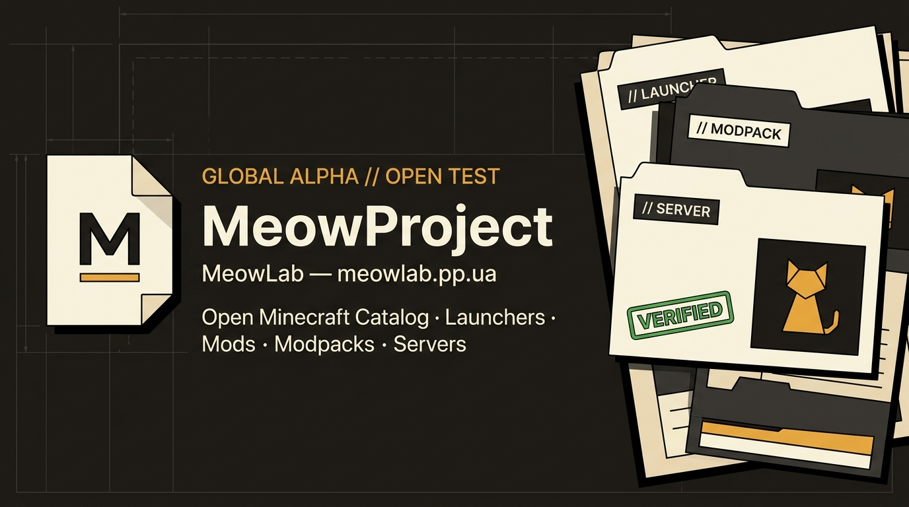

# MeowLab

[](./README.md)
[](./RIDMI-MEOW-I18N/README.uk.md)
[](./RIDMI-MEOW-I18N/README.de.md)
[](./RIDMI-MEOW-I18N/README.pl.md)
[](./RIDMI-MEOW-I18N/README.be.md)
[](./RIDMI-MEOW-I18N/README.kk.md)

[](https://meowlab.pp.ua)
[](https://github.com/BANSAFAn/meowproject/issues)
[](https://gitlab.com/banernotfake/meowproject/-/issues)
[](https://codeberg.org/Baneronetwo/meowlab)

It's just a website.

```text
  ╱|、
(˚ˎ 。7  
 |、˜〵          
 じしˍ,)ノ
```

> The site is still raw (early development, constantly updated). You can leave reviews and comments via **GitHub** or **GitLab**!


