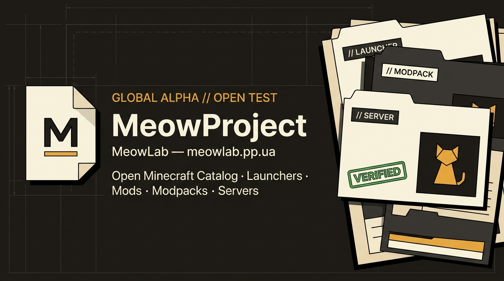

# MeowLab

[](../README.md)
[](./README.uk.md)
[](./README.de.md)
[](./README.pl.md)
[](./README.be.md)
[](./README.kk.md)

[](https://meowlab.pp.ua/pl/)
[](https://github.com/BANSAFAn/meowproject/issues)
[](https://gitlab.com/banernotfake/meowproject/-/issues)

To po prostu strona.

```text
  ╱|、
(˚ˎ 。7  
 |、˜〵          
 じしˍ,)ノ
```

> Strona jest jeszcze we wczesnej fazie rozwoju i jest stale aktualizowana. Opinie i komentarze możesz zostawiać zarówno przez **GitHub**, jak i przez **GitLab**!


